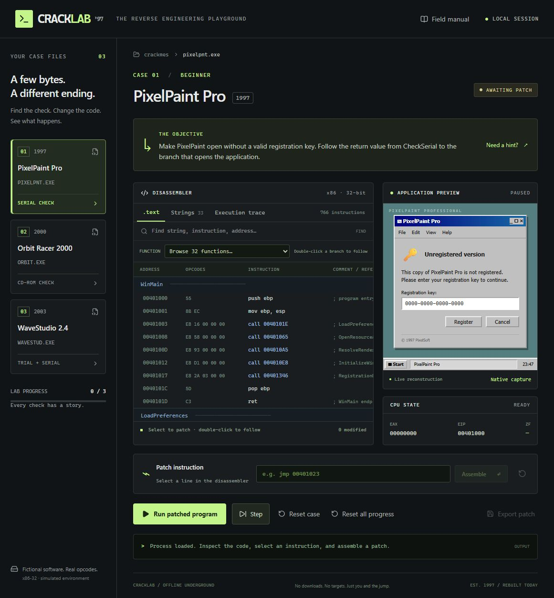

# Cracklab '97

A locally hosted reverse-engineering game about fictional 1997–2003 shareware.

## Play locally

Double-click `start-local.cmd`, or run `npm run dev` from this folder, then open http://localhost:3000. Node 22.13+ is required. If the port is occupied, use the local URL printed by the server. The server binds to loopback. Stop it with Ctrl+C. Dependencies are already installed; after installation the game itself requires no external service or font downloads.

1. Choose a case and scroll through its disassembly. Search by address, opcode, mnemonic, function name, or string. Searching highlights and jumps within the full listing; Enter/Shift+Enter cycles matches. The Strings tab shows data addresses and clickable code cross-references. Double-click branches or local calls to follow them; use the function selector to navigate.
2. Select an instruction, edit the assembly below, and click **Assemble**.
3. **Run patched program** executes the modified byte stream. **Step** shows the register/flag state after each instruction. The execution trace shows the path taken.
4. Hints reveal progressively more help. Reset case clears its patches and saved completion; Reset all progress starts a new game; the undo icon restores only the selected instruction. Export patch saves a JSON manifest. Completion is stored locally in this browser; staged patches reset when switching cases or refreshing.
5. **Native capture** switches the application preview to an actual screenshot of the corresponding compiled Win32 program. The live reconstruction changes when the browser program unlocks.

## Implementation and limits

The React/Vinext game uses a custom bounded x86-32 assembler, decoder, and interpreter in `lib/machine.ts`. It evaluates real instruction bytes and relative branch offsets, rather than checking a hardcoded answer. It supports EAX/AL, ZF, nested local calls, stack-frame allocation and EBP-relative locals, short JZ/JNZ/JMP, NOP, RET, and the documented simulated API calls. It is not Capstone, Unicorn, a complete x86 CPU, a PE loader, or a sandbox for arbitrary executables. Simulated APIs return defined fixture values and preserve ZF. The expanded programs have 766–771 instructions across 32 functions each, with 32–33 addressed strings. Import wrappers have a deliberately simplified one-argument contract and return 1. Other CPU flags, OS calls, and arbitrary register operations remain outside the supported model.

Patches cannot exceed the original slot; unused bytes become NOPs. Branch targets must land on decoded boundaries. Invalid targets, stack imbalance, unsupported calls, and execution beyond 4096 instructions fail. A win requires reaching ShowUnlocked and returning cleanly. Alternate working patches are accepted; the debrief describes one intended solution.

The browser programs are hand-assembled teaching fixtures, **not disassembly of the native executables**. Exported manifests apply to those fixtures only. The native binaries below have compiler-generated prologues, CRT code, and different addresses. The live vintage windows are HTML reconstructions; PNGs under `public/captures` are real captures of the native programs' locked windows, generated by each program's own `PrintWindow` capture mode.

## Native Visual Studio crackmes

Run `npm run native:build` on Windows with Visual Studio's C++ desktop workload installed. The build discovers Visual Studio with vswhere and selects its x86 tools. It produces three programs in `native/build`, plus source/assembly listings, PDBs, and dumpbin disassemblies:

- `case0.exe` — PixelPaint registration gate; a JNZ leads to the accepted path.
- `case1.exe` — Orbit Racer disc gate; CMP EAX,EAX is a two-byte patch site for MOV AL,01.
- `case2.exe` — WaveStudio trial and serial gates.

Compiler flags: `/Od /Ob0 /Oy- /Zi /FAcs`; linker flags: `/INCREMENTAL:NO /OPT:NOREF /OPT:NOICF`. The inline assembly deliberately retains the teachable checks. Native serial input `PIXEL-1997-LAB` is valid for case 0; the disc fixture is absent and the trial fixture expired. These are original examples; they do not check real software licenses, inspect discs, or modify other applications.

Run an EXE normally to interact with its dialog. `--self-test` exits 0 when its invalid-input gate is locked, and 1 otherwise. `--capture relative-path.bmp` saves a screenshot of its own locked window and exits. The latter path should contain no spaces. The UI game does not launch native executables.

## Validation

`npm test` runs the interpreter tests (original failures, all three intended solutions, alternate solution, flag/register semantics, NOP padding, patch sizes, bad targets, API errors, loops, and stack errors). `npm run typecheck` validates TypeScript. `npm run build` builds the webapp.

The page optionally registers a `run_crackme` imperative WebMCP tool when `document.modelContext` is available; it invokes the same run action as the visible button. This optional browser API was not available for live contract verification in this session. No browser interaction/visual QA was performed; HTTP rendering, TypeScript, engine tests, native compilation/self-tests, and production build were checked.
